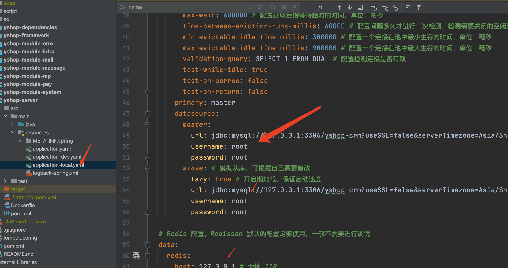
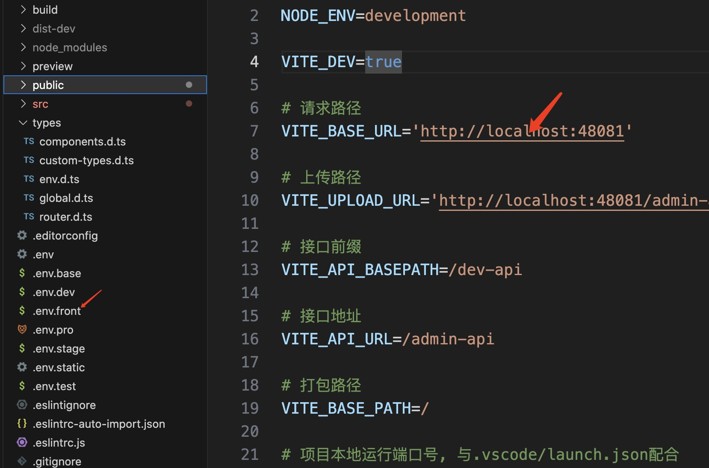

# YSHOP 意象 CRM

> Spring Boot 3 + Vue3 前后端分离，支持企业微信的 CRM 销售管理系统，助力企业销售全流程精细化、数字化管理。

**官网：** [https://www.yixiang.co/](https://www.yixiang.co/)

---

## 产品简介

支持企业微信的前后端分离 CRM，盘活客户资源、量化销售行为、合理配置资源，覆盖销售与项目协同，建立科学销售体系，提升销售业绩。

**定位：** 线索 → 客户 → 商机 → 合同 → 回款 → 项目

**适用：** 销售团队 / 项目管理 / SCRM / 企业微信协同

**技术栈：** Spring Boot 3 · Spring Security OAuth2 · MyBatis Plus · JWT · Redis · Vue3 · uni-app

---

## 演示地址

| 入口 | 说明 |
|------|------|
| 演示地址 | https://www.yixiang.co/p/yixiangcrmxitong.html|
| **二开与定制** |  |

---

## 功能列表

| 模块 | 功能 |
|------|------|
| 待办 | — |
| 办公 | 我的日程、审批管理、流程管理、工作汇报、通知管理 |
| 线索 | 线索管理、线索池、跟进记录 |
| 客户 | 客户管理、发票管理、客户标签、系统配置、自定义表单 |
| 商机 | 商机需求、跟进记录 |
| 合同 | 合同订单、合同签约、合同回款、回款计划 |
| 项目 | 项目分类、项目管理、任务管理 |
| 企微 | 微信配置、微信员工、微信客户、客群列表、客户消息、客户群聊、朋友圈、群发素材、群发工具 |
| 第三方 | 云呼中心、企业钉钉 |
| 数据 | 业绩目标、员工业绩、客户级别、客户来源、客户行业、员工客户量、跟进分析、合同排行、回款排行 |
| 企业 | 员工管理、角色管理、部门管理、岗位管理 |
| 商城 | 商品管理、支付管理 |
| 公众号 | 账号管理、模板消息、标签管理、粉丝管理、消息管理、菜单管理、自动回复、素材管理、图文草稿箱、图文发表记录 |
| 系统 | 租户管理、代码生成、菜单管理、系统接口、文件管理、字典管理、API 日志、审计日志、OAuth 2.0、短信管理、邮箱管理、站内信管理、定时任务、地区管理 |

---

## 视频资料
如果对您有帮助，您可以点右上角 "Star" 支持一下，这样我们才有继续免费下去的动力，谢谢！ QQ交流群 (入群前，请在网页右上角点 "Star" )，群里有视频教程与开发文档哦！！

交流QQ群：544263002

---

## 项目说明

| 目录 | 说明 |
|------|------|
| `yshop-crm` | Java 后端工程 |
| `yshop-crm-vue` | 后台前端 Vue3 工程 |

---

## 本地快速启动

### 1. 环境要求

| 依赖 | 版本 |
|------|------|
| JDK | 17 |
| MySQL | 8 |
| Redis | 6+ |
| Node.js | 16+ |
| Maven | 3.8+ |

### 2. 开发工具

- IDEA（后端）
- VS Code（前端）

### 3. 后端启动

1. 使用 IDEA 打开 Java 工程，自动安装依赖  
2. 创建数据库，导入工程目录下 `sql/yshop-crm.sql`  
3. 修改 `yshop-server` 下 yml 中的数据库与 Redis 配置：

   

4. 在工程目录执行：

   ```bash
   mvn clean install package '-Dmaven.test.skip=true'
   ```

5. 启动项目

### 4. 后台 Vue 启动

1. 用 VS Code 打开 Vue 工程，执行：

   ```bash
   pnpm install
   ```

2. 配置 API：

   

3. 本地启动：

   ```bash
   npm run dev
   ```

---

## 手机端截图

| | |
|:---:|:---:|
|  |  |
|  |  |
|  |  |

---

## 后台截图

| |
|:---:|
|  |
| |
| |
|  |
|  |
|  |

---

## 技术栈

**后端：** Spring Boot 3 · Spring Security OAuth2 · MyBatis / MyBatis Plus · Redis · Lombok · Hutool

**前端：** Vue 3 · Element Plus · uni-app（Vue3）

---

## 特别鸣谢

- [ruoyi-vue-pro](https://gitee.com/zhijiantianya/ruoyi-vue-pro)
- [Element Plus](https://element-plus.gitee.io/zh-CN/)
- [Vue](https://cn.vuejs.org/)
- [pay-java-parent](https://gitee.com/egzosn/pay-java-parent)

---

## 开源协议

本项目采用比 Apache 2.0 更宽松的 [MIT License](https://gitee.com/guchengwuyue/crm/blob/master/LICENSE) 开源协议，个人与企业可 100% 免费使用，不用保留类作者、Copyright 信息。
